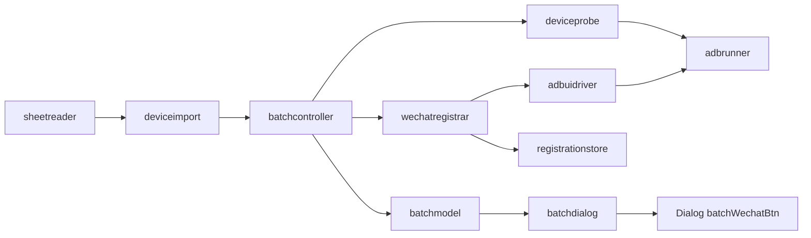

# WeChat Batch Registration over Tailscale Implementation Plan

> **For agentic workers:** REQUIRED SUB-SKILL: Use superpowers:subagent-driven-development (recommended) or superpowers:executing-plans to implement this plan task-by-task. Steps use checkbox (`- [ ]`) syntax for tracking.

**Goal:** Add a "Batch WeChat" window to QtScrcpy that imports an Excel sheet of Tailscale device IPs and phone numbers, verifies every device is connected, installs WeChat (from a user-chosen APK) where missing, and registers WeChat accounts on user-selected devices with no human interaction on the happy path, logging each registered device.

**Architecture:** A new non-UI static library `qsc_batch` (`QtScrcpy/batch/`) holds all logic: sheet import, a standalone blocking `AdbRunner` (the existing `qsc::AdbProcess` is single-flight and cannot run many devices at once), device probes, a WeChat registration state machine driven through a mockable `IUiDriver` (adb `uiautomator dump` / `input` / SMS read), a result store, and a thread-pool `BatchController`. A new `BatchDialog` (Qt Widgets, code-built like `initAdvancedConfigUi`) is the view and is opened from one new button in the main `Dialog`. Nothing in the `QtScrcpyCore` submodule is modified.

**Tech Stack:** C++11 (project-wide `CMAKE_CXX_STANDARD 11`), Qt 5.15.2 (`~/Qt/5.15.2/clang_64`, must also stay Qt6-compatible), CMake >= 3.19, Qt Test, vendored miniz (MIT, C) for `.xlsx` unzip, adb (bundled / `QTSCRCPY_ADB_PATH`).

**Spec:** This document's "Requirements" section (no separate spec exists). Provisional rulings below were made on the user's behalf and are listed in "Rulings".

## Requirements

- R1. Upload an `.xlsx` (and `.csv`) sheet with Tailscale IP + phone number per device.
- R2. On upload, check connectivity of every device; show per-device state and an "N of M connected" summary.
- R3. One button: for all connected devices check whether `com.tencent.mm` is installed; if not, install the WeChat APK the user uploaded.
- R4. A second button registers WeChat accounts on devices the user selects (checkbox per row), using that row's phone number, fully automated (SMS code read from the same device over adb).
- R5. On success write a log line and mark that Tailscale IP device as registered, persistently.
- R6. Failures that need a human (captcha / risk control) are classified and logged, never retried forever and never bypassed.

## Global Constraints

- C++11 only: no `std::optional`, `std::make_unique`, structured bindings, generic lambdas. Build flags are `-Wall -Wextra -pedantic -Werror` (clang/gcc); code must compile warning-free.
- Must compile with Qt 5.15.2 and Qt 6: use `QRegularExpression` (never `QRegExp`), guard `Qt::SkipEmptyParts` with `QT_VERSION` like `dialog.cpp:727-731`.
- Do not modify `QtScrcpy/QtScrcpyCore/` (git submodule). Resolve adb path in `AdbRunner` with the same order the core uses: env `QTSCRCPY_ADB_PATH`, configured `AdbPath`, `<applicationDirPath>/adb[.exe]`.
- Device hosts must be IPv4 literals and not public-routable (reuse the rule in `Dialog::isPublicRoutableIPv4`; 100.64.0.0/10 is allowed). Default port `5555`.
- WeChat package is exactly `com.tencent.mm`; launcher activity `com.tencent.mm/.ui.LauncherUI`.
- Never run `pm clear`, `pm uninstall`, or factory-reset commands. Never write passwords or SMS codes to any log or the CSV.
- No blocking of the GUI thread: every adb call runs in the controller's own `QThreadPool`; the UI only receives queued signals.
- Persisted data lives under `QStandardPaths::AppDataLocation + "/wechat_batch/"` (`settings.ini`, `registrations.csv`); the CSV is created with owner-only permissions.
- The working tree has unrelated uncommitted edits (`dialog.cpp`, `dialog.h`, `adbprocessimpl.cpp`, README, CI script). Commit only the paths each task names; for `dialog.*` use `git add -p` and stage only this feature's hunks.
- UI (ui-ux-pro-max, adapted to desktop Qt): follow the existing app theme (no new dark theme); status is always icon + text, never color alone; text/background contrast >= 4.5:1 in light and dark palettes (derive colors from `QPalette`); every action button has a disabled state with a tooltip saying why; long jobs show a progress bar and a Cancel button; full keyboard operation with a defined tab order and accessible names; no emojis as icons (use `QStyle::standardIcon`).

## Review Focus

1. Excel phone cells stored as numbers (`9.8765E+9`, lost leading zeros, spaces/dashes/parentheses, leading `+`): expect clean digits or a row-level error naming the sheet row. Pinned in Task 2.
2. Duplicate IPs or the same phone on two devices: expect the second row flagged and skipped, never two registration attempts for one number. Pinned in Task 2.
3. Device `unauthorized` (RSA prompt not accepted), `offline`, or an unreachable Tailscale IP: expect a distinct row state within a bounded timeout, no UI freeze. Pinned in Task 4.
4. WeChat challenge screens (slider/captcha, "already registered", "too frequent", already logged in): expect a classified outcome and the next device to proceed; one device never loops past its deadline. Pinned in Task 7.
5. Cancel mid-run or quitting the app during a run: expect running adb children killed and rows left as `Cancelled`, not stuck `Running`. Pinned in Tasks 3 and 8.
6. A stale SMS code from an earlier registration must not be used. Pinned in Task 6.

## File Structure

- Create `QtScrcpy/batch/devicerow.h` - `DeviceRow` and state enums.
- Create `QtScrcpy/batch/hostcheck.{h,cpp}` - IPv4/public-IP rule extracted from `Dialog`.
- Create `QtScrcpy/batch/sheetreader.{h,cpp}` - raw table from `.xlsx`/`.csv`.
- Create `QtScrcpy/batch/deviceimport.{h,cpp}` - table to validated `DeviceRow`s.
- Create `QtScrcpy/batch/adbrunner.{h,cpp}` - blocking adb with timeout and cancel.
- Create `QtScrcpy/batch/deviceprobe.{h,cpp}` - connect / WeChat installed / install.
- Create `QtScrcpy/batch/registrationstore.{h,cpp}` - persisted results.
- Create `QtScrcpy/batch/uidump.{h,cpp}`, `smsreader.{h,cpp}` - pure parsers.
- Create `QtScrcpy/batch/wechatregistrar.{h,cpp}`, `adbuidriver.{h,cpp}` - state machine + real driver.
- Create `QtScrcpy/batch/batchmodel.{h,cpp}`, `batchcontroller.{h,cpp}`, `batchsettings.{h,cpp}`.
- Create `QtScrcpy/batch/third_party/miniz/` - vendored miniz amalgamation + `CMakeLists.txt`.
- Create `QtScrcpy/ui/batchdialog.{h,cpp}` - view.
- Create `QtScrcpy/tests/` - `CMakeLists.txt`, one `tst_*.cpp` per task, `fixtures/`.
- Modify `QtScrcpy/CMakeLists.txt`, `QtScrcpy/ui/dialog.{h,cpp,ui}`, `README.md` (short usage section).

---

### Task 1: Batch library scaffold, shared types, test harness

**Files:**
- Create: `QtScrcpy/batch/devicerow.h`, `QtScrcpy/batch/hostcheck.h`, `QtScrcpy/batch/hostcheck.cpp`, `QtScrcpy/tests/CMakeLists.txt`, `QtScrcpy/tests/tst_hostcheck.cpp`
- Modify: `QtScrcpy/CMakeLists.txt` (`project(... LANGUAGES CXX C)`, new `qsc_batch` static lib, `option(QSC_BUILD_TESTS OFF)`), `QtScrcpy/ui/dialog.cpp:763-795` (delegate to `batch::HostCheck`)

**Interfaces:**
- Produces (namespace `batch`):
  - `enum class ConnState { Unknown, Checking, Connected, Unauthorized, Offline, Unreachable, Invalid };`
  - `enum class WechatState { Unknown, Checking, Installed, Missing, Installing, InstallFailed };`
  - `enum class RegState { Idle, Running, Registered, AlreadyRegistered, NeedsManual, Failed, Cancelled };`
  - `struct DeviceRow { QString ip; quint16 port = 5555; QString phone; ConnState conn = ConnState::Unknown; WechatState wechat = WechatState::Unknown; RegState reg = RegState::Idle; QString wechatVersion; QString detail; QString serial() const; /* "ip:port" */ };`
  - `bool HostCheck::isIPv4Literal(const QString &)`, `bool HostCheck::isPublicRoutableIPv4(const QString &)` (static, same masks as current `Dialog` version).

- [ ] **Step 1: Write failing test `tst_hostcheck.cpp`** with `isPublicRoutableIPv4("100.101.102.103") == false`, `("192.168.1.5") == false`, `("8.8.8.8") == true`, `isIPv4Literal("100.1.2") == false`, `isIPv4Literal("tailscale-host") == false`.
- [ ] **Step 2: Add the test harness.** `QtScrcpy/tests/CMakeLists.txt` defines a helper `qsc_add_test(name)` (Qt5/Qt6 `Test`, links `qsc_batch`, `add_test`); gated by `if(QSC_BUILD_TESTS) enable_testing() add_subdirectory(tests) endif()`. Run: `cd /Users/wonder/codes/qtscrcoy && cmake -S . -B build-tests -DQSC_BUILD_TESTS=ON -DCMAKE_PREFIX_PATH=$HOME/Qt/5.15.2/clang_64 -DCMAKE_OSX_ARCHITECTURES=x86_64 && cmake --build build-tests --target tst_hostcheck`. Expected: link/compile FAIL (`HostCheck` undefined). If `cmake` is not on PATH, install it first (`brew install cmake`) and note it in the ledger.
- [ ] **Step 3: Implement `qsc_batch` (static, links Qt Core only; sources globbed explicitly, not `file(GLOB)`) plus `hostcheck.{h,cpp}`; move the logic out of `Dialog::isPublicRoutableIPv4` and make that function call `batch::HostCheck::isPublicRoutableIPv4`.** Link `qsc_batch` into the `QtScrcpy` executable. Add `QC_BATCH_SOURCES` source group.
- [ ] **Step 4: Verify.** Run `cmake --build build-tests --target tst_hostcheck && cd build-tests && ctest -R hostcheck --output-on-failure`. Expected: PASS. Then run the normal app build (`ENV_QT_PATH=$HOME/Qt/5.15.2 ci/mac/build_for_mac.sh RelWithDebInfo x64`) and confirm it still links.
- [ ] **Step 5: Commit** `git add QtScrcpy/batch QtScrcpy/tests QtScrcpy/CMakeLists.txt && git add -p QtScrcpy/ui/dialog.cpp && git commit -m "feat(batch): scaffold qsc_batch library and test harness"`

### Task 2: Excel/CSV import

**Files:**
- Create: `QtScrcpy/batch/sheetreader.{h,cpp}`, `QtScrcpy/batch/deviceimport.{h,cpp}`, `QtScrcpy/batch/third_party/miniz/{miniz.c,miniz.h,CMakeLists.txt}`, `QtScrcpy/tests/tst_import.cpp`, `QtScrcpy/tests/fixtures/{devices_ok.xlsx,devices_numeric_phone.xlsx,devices_ok.csv,make_fixtures.py}`
- Modify: `QtScrcpy/batch/CMakeLists`/top `QtScrcpy/CMakeLists.txt` to add `qsc_miniz` (C static lib, `-w`) and link it into `qsc_batch`

**Interfaces:**
- Consumes: `DeviceRow`, `HostCheck` (Task 1).
- Produces:
  - `typedef QList<QStringList> SheetTable;` `SheetTable SheetReader::read(const QString &path, QString *error);` (first sheet only; `.xlsx` via miniz + `QXmlStreamReader` over `xl/sharedStrings.xml` and `xl/worksheets/sheet1.xml`; `.csv` UTF-8 with BOM tolerated; `.xls` returns error "Save as .xlsx").
  - `struct ImportResult { QList<DeviceRow> rows; QStringList warnings; QString error; };` `ImportResult DeviceImport::fromTable(const SheetTable &table);`
- Header rules: case-insensitive; IP column aliases `tailscale_ip, ip, tailscale ip, device ip`; phone aliases `phone, phone_number, number, mobile`; optional `port`. Missing required header sets `error`. Phone normalised to digits with optional single leading `+`, length 7-15 digits.

- [ ] **Step 1: Write failing tests** in `tst_import.cpp`: `readsXlsxBasic` (3 rows from `devices_ok.xlsx` -> 3 `DeviceRow`s, port 5555), `readsCsvSameAsXlsx`, `numericPhoneCellsNormalised` (`9.8765E+9` -> `"9876500000"`, `"+91 98765-43210"` -> `"+919876543210"`), `duplicateIpSkippedWithWarning` (warning contains `"row 3"`), `duplicatePhoneSkippedWithWarning`, `publicIpRowRejected`, `missingPhoneHeaderErrors`, `xlsRejectedWithMessage`.
- [ ] **Step 2: Run** `cmake --build build-tests --target tst_import && (cd build-tests && ctest -R import --output-on-failure)`. Expected: FAIL (symbols undefined).
- [ ] **Step 3: Vendor miniz** (latest 3.x amalgamation from the official `richgel999/miniz` release; MIT licence file kept next to it) and implement `SheetReader` with `mz_zip_reader_extract_file_to_heap`. Cells of type `s` resolve through shared strings; numeric cells keep the raw `<v>` text, and phone normalisation converts exponent notation with `QString::number(value, 'f', 0)`.
- [ ] **Step 4: Implement `DeviceImport::fromTable`.** Invalid rows go to `warnings` as `"row N: <reason>"` (N = 1-based sheet row incl. header) and are skipped; keep input order.
- [ ] **Step 5: Run tests.** Expected: all PASS.
- [ ] **Step 6: Commit** `git add QtScrcpy/batch QtScrcpy/tests QtScrcpy/CMakeLists.txt && git commit -m "feat(batch): import devices from xlsx/csv"`

### Task 3: AdbRunner (blocking, cancellable)

**Files:**
- Create: `QtScrcpy/batch/adbrunner.{h,cpp}`, `QtScrcpy/tests/tst_adbrunner.cpp`, `QtScrcpy/tests/fixtures/fake_adb.sh`
- Test env: `QTSCRCPY_ADB_PATH` points at `fake_adb.sh`, which prints `$FAKE_ADB_DIR/<args joined, " /:" replaced by "_">.txt` and exits with the integer in the matching `.code` file (default 0); a file named `<key>.sleep` makes it sleep that many seconds first.

**Interfaces:**
- Produces:
  - `struct AdbResult { bool started = false; bool timedOut = false; bool cancelled = false; int exitCode = -1; QString out; QString err; bool ok() const; /* started && !timedOut && !cancelled && exitCode == 0 */ };`
  - `class AdbRunner { public: static void setConfiguredAdbPath(const QString &); static QString adbPath(); static AdbResult run(const QString &serial, const QStringList &args, int timeoutMs, const std::atomic<bool> *cancel = nullptr); };`
  - `serial` empty means no `-s`.

- [ ] **Step 1: Write failing tests:** `runsAndCapturesStdout`, `nonZeroExitIsNotOk`, `timeoutKillsProcess` (script sleeps 5 s, `timeoutMs=300` -> `timedOut && !ok()` in < 2 s), `cancelFlagKillsProcess` (flag set from a `QTimer` thread after 200 ms -> `cancelled`), `missingBinaryReported` (`started == false`).
- [ ] **Step 2: Run** `cmake --build build-tests --target tst_adbrunner && (cd build-tests && ctest -R adbrunner --output-on-failure)`. Expected: FAIL.
- [ ] **Step 3: Implement** with a fresh `QProcess` per call, poll `waitForFinished(100)` in a loop checking deadline and cancel flag; `kill()` then `waitForFinished(1000)` on timeout/cancel.
- [ ] **Step 4: Run tests.** Expected: PASS.
- [ ] **Step 5: Commit** `git add QtScrcpy/batch QtScrcpy/tests && git commit -m "feat(batch): blocking cancellable AdbRunner"`

### Task 4: Device probes (connect, WeChat installed, install)

**Files:**
- Create: `QtScrcpy/batch/deviceprobe.{h,cpp}`, `QtScrcpy/tests/tst_deviceprobe.cpp`

**Interfaces:**
- Consumes: `AdbRunner::run`, `DeviceRow`.
- Produces (namespace `batch`, static members of `DeviceProbe`, each takes the cancel flag as last arg defaulting to `nullptr`):
  - `ConnState probeConnection(DeviceRow &row, const std::atomic<bool> *cancel)` - runs `connect ip:port` (8 s) then `-s serial get-state` (5 s). `device` -> `Connected` and fills `row.detail` with `ro.product.model`; output containing `unauthorized` -> `Unauthorized`; `offline` -> `Offline`; anything else/timeout -> `Unreachable`.
  - `WechatState probeWechat(DeviceRow &row, const std::atomic<bool> *cancel)` - `shell pm path com.tencent.mm` (output starts `package:` -> `Installed`, fills `wechatVersion` from `dumpsys package com.tencent.mm` `versionName=`).
  - `bool installWechat(DeviceRow &row, const QString &apkPath, QString *error, const std::atomic<bool> *cancel)` - `install -r <apk>` with 10 min timeout; `Success` -> true; `INSTALL_FAILED_*` mapped to short messages (`NO_MATCHING_ABIS`, `USER_RESTRICTED`, `INSUFFICIENT_STORAGE`, `VERSION_DOWNGRADE`, others passed through); sets `row.wechat`.

- [ ] **Step 1: Write failing tests** against `fake_adb.sh` fixtures: `connectedDevice`, `unauthorizedDevice`, `offlineDevice`, `unreachableTimesOutWithin15s` (script sleeps), `wechatInstalledWithVersion`, `wechatMissing`, `installSuccess`, `installNoMatchingAbis` (error text contains `ABI`), `installRejectsMissingApkFile` (no adb call made).
- [ ] **Step 2: Run** `cmake --build build-tests --target tst_deviceprobe && (cd build-tests && ctest -R deviceprobe --output-on-failure)`. Expected: FAIL.
- [ ] **Step 3: Implement the three functions** per the contract above.
- [ ] **Step 4: Run tests.** Expected: PASS.
- [ ] **Step 5: Commit** `git add QtScrcpy/batch QtScrcpy/tests && git commit -m "feat(batch): connection and WeChat install probes"`

### Task 5: Registration store

**Files:**
- Create: `QtScrcpy/batch/registrationstore.{h,cpp}`, `QtScrcpy/batch/batchsettings.{h,cpp}`, `QtScrcpy/tests/tst_store.cpp`

**Interfaces:**
- Produces:
  - `struct RegistrationRecord { QDateTime time; QString ip; QString phone; RegState state; QString detail; };`
  - `class RegistrationStore { public: explicit RegistrationStore(const QString &dir); void append(const RegistrationRecord &); bool isRegistered(const QString &ip, const QString &phone) const; QString csvPath() const; };` CSV columns `timestamp_iso,ip,phone,state,detail`; `isRegistered` true when the latest record for the pair has state `Registered` or `AlreadyRegistered`; file created `0600`; fields quoted/escaped.
  - `class BatchSettings { public: explicit BatchSettings(const QString &dir); QString apkPath() const; void setApkPath(const QString &); int concurrency() const; /* default 3, clamped 1..8 */ void setConcurrency(int); };`

- [ ] **Step 1: Write failing tests:** `appendThenIsRegistered`, `latestRecordWins` (Registered then Failed -> `isRegistered` false), `csvEscapesCommasAndQuotes`, `fileIsOwnerOnly` (`QFile::permissions` has no group/other bits), `survivesReopen`, `concurrencyClamped`.
- [ ] **Step 2: Run** `cmake --build build-tests --target tst_store && (cd build-tests && ctest -R store --output-on-failure)`. Expected: FAIL.
- [ ] **Step 3: Implement** (append-only CSV, in-memory map rebuilt on construct; `BatchSettings` over `QSettings(dir + "/settings.ini", IniFormat)`).
- [ ] **Step 4: Run tests.** Expected: PASS.
- [ ] **Step 5: Commit** `git add QtScrcpy/batch QtScrcpy/tests && git commit -m "feat(batch): persisted registration store and settings"`

### Task 6: UI-dump and SMS parsers

**Files:**
- Create: `QtScrcpy/batch/uidump.{h,cpp}`, `QtScrcpy/batch/smsreader.{h,cpp}`, `QtScrcpy/tests/tst_parsers.cpp`, `QtScrcpy/tests/fixtures/ui_*.xml`, `sms_*.txt` (synthetic now; replaced by real captures in Task 10)

**Interfaces:**
- Produces:
  - `struct UiNode { QString text, desc, resId, cls; QRect bounds; bool clickable = false; bool enabled = true; QPoint center() const; };`
  - `QList<UiNode> UiDump::parse(const QString &xml);` (`uiautomator dump` format, `bounds="[l,t][r,b]"`)
  - `const UiNode *UiDump::findAny(const QList<UiNode> &, const QStringList &textsOrDescs, bool exact = false);` (case-insensitive; matches `text` or `desc`)
  - `QList<UiNode> UiDump::editTexts(const QList<UiNode> &);` (class `android.widget.EditText`, ordered top to bottom)
  - `struct SmsMessage { qint64 dateMs = 0; QString address; QString body; };`
  - `QList<SmsMessage> SmsReader::parseContentQuery(const QString &out);` (rows `Row: N address=..., body=..., date=...`, body may contain commas)
  - `QString SmsReader::extractWechatCode(const QList<SmsMessage> &msgs, qint64 notBeforeMs);` newest message mentioning `WeChat|Weixin|微信` with a 6-digit code and `dateMs >= notBeforeMs`.
  - `QString SmsReader::extractCodeFromNotifications(const QString &dumpsysOut);` fallback, same keyword + 6 digits rule.

- [ ] **Step 1: Write failing tests:** `parsesBoundsAndCenter`, `findAnyMatchesChineseAndEnglish`, `editTextsSortedByY`, `smsBodyWithCommasParsed`, `codeExtractedForWechatMessage` (`"WeChat: 482913 is your verification code"` -> `482913`), `chineseMessageExtracted` (`"【微信】验证码 135790"`), `staleCodeIgnored` (message older than `notBeforeMs` -> empty), `nonWechatSixDigitsIgnored`, `notificationFallback`.
- [ ] **Step 2: Run** `cmake --build build-tests --target tst_parsers && (cd build-tests && ctest -R parsers --output-on-failure)`. Expected: FAIL.
- [ ] **Step 3: Implement** with `QXmlStreamReader` and `QRegularExpression`.
- [ ] **Step 4: Run tests.** Expected: PASS.
- [ ] **Step 5: Commit** `git add QtScrcpy/batch QtScrcpy/tests && git commit -m "feat(batch): uiautomator and SMS parsers"`

### Task 7: WeChat registrar state machine

**Files:**
- Create: `QtScrcpy/batch/wechatregistrar.{h,cpp}`, `QtScrcpy/batch/adbuidriver.{h,cpp}`, `QtScrcpy/tests/tst_registrar.cpp`, `QtScrcpy/tests/fixtures/flow_*/` (ordered screen XMLs per scenario)

**Interfaces:**
- Consumes: `UiDump`, `SmsReader` (Task 6), `AdbRunner` (Task 3), `DeviceRow`.
- Produces:
  - `class IUiDriver { public: virtual ~IUiDriver(); virtual QList<UiNode> dump() = 0; virtual bool tap(int x, int y) = 0; virtual bool typeText(const QString &asciiText) = 0; virtual bool pressBack() = 0; virtual bool launchWechat() = 0; virtual QList<SmsMessage> readSms() = 0; virtual QString notificationDump() = 0; virtual qint64 deviceNowMs() = 0; virtual void sleepMs(int ms) = 0; virtual bool cancelled() const = 0; };`
  - `struct RegisterOptions { int stepTimeoutSec = 20; int smsTimeoutSec = 120; int deviceDeadlineSec = 600; int maxSmsResend = 1; };`
  - `struct RegisterOutcome { RegState state; QString detail; };`
  - `RegisterOutcome WechatRegistrar::run(const DeviceRow &row, IUiDriver &driver, const RegisterOptions &opts, const std::function<void(const QString &)> &log);`
  - `QString WechatRegistrar::generatePassword();` 12 chars, letters and digits, at least one of each; `QString generateNickname();` ASCII, 8 chars starting with a letter.
  - `class AdbUiDriver : public IUiDriver` (ctor `AdbUiDriver(const QString &serial, const std::atomic<bool> *cancel)`): dump via `shell uiautomator dump /sdcard/qsc_ui.xml` + `exec-out cat`; `typeText` via `shell input text` with spaces as `%s`; SMS via `shell content query --uri content://sms/inbox --projection address:body:date --sort "date DESC"`; `deviceNowMs` via `shell date +%s` x 1000; `launchWechat` via `shell am start -n com.tencent.mm/.ui.LauncherUI`.
- State machine: Launch -> (dismiss permission/privacy dialogs: `Agree|同意`, `Allow|允许|While using the app`) -> tap `Register|注册` -> fill `editTexts()` top-to-bottom as nickname, phone, password (region chosen by tapping the row whose text matches the dial code when `row.phone` starts with `+`, then searching the picker for `+<code>`) -> tick agreement -> `Next|下一步` -> wait for SMS (`notBeforeMs = deviceNowMs() at Next - 30000`) -> type code -> `Next` -> success when main tab bar texts (`Chats|微信`, `Contacts|通讯录`, `Discover|发现`, `Me|我`) are present. Terminal classifications: main screen at launch -> `AlreadyRegistered` ("device already logged in"); text `already registered|已注册|already linked` -> `AlreadyRegistered`; `Security Verification|安全验证|drag|拖动|puzzle|拼图` -> `NeedsManual`; `too frequent|过于频繁|try again later|稍后再试` -> `Failed` ("rate limited"); no screen progress for `stepTimeoutSec`, SMS not arrived after `smsTimeoutSec` (after `maxSmsResend` resends via `Resend|重新发送`), or `deviceDeadlineSec` exceeded -> `Failed` with reason; `driver.cancelled()` at any poll -> `Cancelled`. `log` receives step names only, never password or code.

- [ ] **Step 1: Write failing tests** with a `FakeDriver` replaying screen sequences (advance one screen per `tap`/`typeText`/`launchWechat`): `happyPathRegisters` (outcome `Registered`; typed texts include the phone digits and a generated password; `log` lines contain neither the password nor the code), `mainScreenAtStartIsAlreadyRegistered`, `alreadyRegisteredText`, `captchaIsNeedsManual` (no further taps after detection), `rateLimitedFails`, `smsTimeoutFails` (fake clock via `sleepMs`), `staleSmsNotUsed`, `deadlineStopsLoop`, `cancelReturnsCancelled`, `countryCodeSelectsRegion` (phone `+91...` taps the `+91` row and types the national number only), `generatedPasswordShape`.
- [ ] **Step 2: Run** `cmake --build build-tests --target tst_registrar && (cd build-tests && ctest -R registrar --output-on-failure)`. Expected: FAIL.
- [ ] **Step 3: Implement `WechatRegistrar::run` as a screen classifier loop** (`classify(nodes) -> Screen` from a text-variant table in English and Simplified Chinese, then one action per iteration) and `AdbUiDriver`. Keep text variants in one table in `wechatregistrar.cpp` so Task 10 calibration edits one place.
- [ ] **Step 4: Run tests.** Expected: PASS.
- [ ] **Step 5: Commit** `git add QtScrcpy/batch QtScrcpy/tests && git commit -m "feat(batch): WeChat registration state machine"`

### Task 8: Model and controller

**Files:**
- Create: `QtScrcpy/batch/batchmodel.{h,cpp}`, `QtScrcpy/batch/batchcontroller.{h,cpp}`, `QtScrcpy/tests/tst_controller.cpp`

**Interfaces:**
- Consumes: Tasks 1-7.
- Produces:
  - `class BatchModel : public QAbstractTableModel` with `enum Column { ColSelect, ColIp, ColPhone, ColConn, ColWechat, ColReg, ColDetail, ColCount };` `void setRows(const QList<DeviceRow> &)`, `const DeviceRow &row(int) const`, `void updateRow(int, const DeviceRow &)`, `QList<int> checkedRows() const`, `void setAllChecked(bool)`, check state editable via `Qt::CheckStateRole` in `ColSelect`. Display text per state is a fixed English label (`Connected`, `Unauthorized (accept prompt on phone)`, `Offline`, `Unreachable`, `Installed 8.0.x`, `Missing`, `Registered`, `Needs manual`, ...); `Qt::DecorationRole` returns a `QStyle::standardIcon` per state class, `Qt::ForegroundRole` uses palette-derived colors.
  - `class BatchController : public QObject { BatchController(const QString &dataDir, QObject *parent = nullptr); BatchModel *model(); bool loadSheet(const QString &path, QString *error); void checkAll(); void ensureWechat(const QString &apkPath); void registerRows(const QList<int> &rows); void cancel(); bool isBusy() const; QString resultsCsvPath() const; signals: void logLine(const QString &); void progress(int done, int total); void busyChanged(bool); void summaryChanged(int total, int connected, int wechatInstalled, int registered); };`
  - Rules: own `QThreadPool` (`maxThreadCount = settings.concurrency()`); one job per row; workers receive a `DeviceRow` copy and post results back with queued invocation; a single run at a time (`isBusy()` guards re-entry); `ensureWechat` only touches `Connected` rows; `registerRows` skips rows that are not `Connected`, not `Installed`, or already `Registered` (log `skipped <ip>: <reason>`); `loadSheet` marks rows already in the store as `Registered`, then starts `checkAll` itself; on success `logLine("[REGISTERED] <ip>:<port> <phone>")` and a store record; destructor/`cancel()` set the shared cancel flag, `waitForDone`, and set unfinished rows to `Cancelled`/`Unknown`.

- [ ] **Step 1: Write failing tests** with `fake_adb.sh` and a stub registrar hook (`BatchController::setRegistrarFactory(std::function<RegisterOutcome(const DeviceRow &, const std::atomic<bool> *)>)` for tests): `loadSheetChecksAllDevices` (summary `3 of 3 connected`), `partialConnectionBlocksOnlyThoseRows` (unreachable row never receives install/register calls), `ensureWechatInstallsOnlyMissing`, `registerSkipsNotInstalledAndAlreadyRegistered`, `registeredRowWritesLogAndStore`, `cancelLeavesNoRunningRows`, `secondRunRejectedWhileBusy`, `concurrencyLimitRespected` (max simultaneous registrar calls <= setting).
- [ ] **Step 2: Run** `cmake --build build-tests --target tst_controller && (cd build-tests && ctest -R controller --output-on-failure)`. Expected: FAIL.
- [ ] **Step 3: Implement model and controller** per the rules above.
- [ ] **Step 4: Run the full suite** `cd build-tests && ctest --output-on-failure`. Expected: all PASS.
- [ ] **Step 5: Commit** `git add QtScrcpy/batch QtScrcpy/tests && git commit -m "feat(batch): batch model and thread-pool controller"`

### Task 9: Batch dialog and main-window entry point

**Files:**
- Create: `QtScrcpy/ui/batchdialog.{h,cpp}`
- Modify: `QtScrcpy/ui/dialog.ui` (new `QPushButton batchWechatBtn`, text `Batch WeChat...`, after `wirelessDisConnectBtn` at the end of `wirelessGroupBox`, `autoDefault=false`), `QtScrcpy/ui/dialog.h` (`void on_batchWechatBtn_clicked();`, `QPointer<BatchDialog> m_batchDialog;`), `QtScrcpy/ui/dialog.cpp` (slot creates or raises the dialog, `Qt::WA_DeleteOnClose`, connects `BatchController::logLine` to `Dialog::outLog`), `QtScrcpy/CMakeLists.txt` (add `ui/batchdialog.*` to `QC_UI_SOURCES`), `README.md` (usage section: sheet columns, buttons, outcomes)

**Interfaces:**
- Consumes: `BatchController` (Task 8), `BatchSettings` (Task 5).
- Produces: `class BatchDialog : public QDialog { BatchDialog(QWidget *parent = nullptr); signals: void logLine(const QString &); };` (forwards controller log).
- Layout (top to bottom): toolbar `Upload Excel...` | `Re-check connections` | `WeChat APK: <path or "not chosen">` `Choose APK...` | `Parallel devices` spin 1-8; summary strip (`12 devices | 11 connected | 8 WeChat installed | 5 registered`, with a warning icon + text when not all are connected); `QTableView` on `BatchModel` (sortable, header checkbox select-all, row selection plus checkbox column); action bar: `Check / Install WeChat` (R3, one click, acts on all connected rows), `Register selected` (R4), `Cancel` (visible only while busy), `QProgressBar`; bottom read-only log `QPlainTextEdit` with timestamps and `Open results CSV`.
- Behaviour: Install button disabled (tooltip `Upload a sheet and wait for at least one connected device`) until >= 1 connected; if no APK path is stored it opens `QFileDialog` (`*.apk`) first and persists it; Register button disabled unless >= 1 checked row is `Connected` + `Installed` + not `Registered`, with tooltip stating the missing condition; clicking Register shows one confirmation (`Register N WeChat accounts with the listed phone numbers? Automation cannot solve captchas; those devices will be marked "Needs manual".`); all buttons except Cancel are disabled while `isBusy()`; closing the window while busy asks to cancel first. Tab order: Upload, Re-check, Choose APK, Parallel, table, Install, Register, Cancel, log. Accessible names set on every control.

- [ ] **Step 1: Write the failing UI smoke test** `tst_batchdialog.cpp` (offscreen platform, `QT_QPA_PLATFORM=offscreen`): `registerDisabledUntilEligibleRowChecked`, `installDisabledWithoutConnectedDevices`, `cancelHiddenWhenIdle`, `confirmationDeclinedStartsNothing` (inject a `setConfirmHook`). Run `cmake --build build-tests --target tst_batchdialog && (cd build-tests && QT_QPA_PLATFORM=offscreen ctest -R batchdialog --output-on-failure)`. Expected: FAIL.
- [ ] **Step 2: Implement `BatchDialog`** per the layout and behaviour above, reusing the app theme (no custom stylesheet beyond palette-derived status colors).
- [ ] **Step 3: Wire the main `Dialog`** (button, slot, log connection) and add the CMake entries; call `AdbRunner::setConfiguredAdbPath(Config::getInstance().getAdbPath())` in the slot before creating the dialog.
- [ ] **Step 4: Run tests and build the app.** `cd build-tests && QT_QPA_PLATFORM=offscreen ctest --output-on-failure` PASS; `ENV_QT_PATH=$HOME/Qt/5.15.2 ci/mac/build_for_mac.sh RelWithDebInfo x64` succeeds. Launch the app, press `Batch WeChat...`, confirm the window opens and the disabled-state tooltips read correctly.
- [ ] **Step 5: Commit** `git add QtScrcpy/ui/batchdialog.* QtScrcpy/tests README.md QtScrcpy/CMakeLists.txt && git add -p QtScrcpy/ui/dialog.cpp QtScrcpy/ui/dialog.h QtScrcpy/ui/dialog.ui && git commit -m "feat(ui): batch WeChat dialog"`

### Task 10: Real-device calibration and end-to-end verification

**Files:**
- Modify: `QtScrcpy/batch/wechatregistrar.cpp` (text-variant table only), `QtScrcpy/tests/fixtures/` (real captures replace synthetic ones), `docs/FAQ.md` (known limits)

- [ ] **Step 1: Capture real screens** from one Tailscale-connected device with the target WeChat version: run `adb -s <ip:5555> shell uiautomator dump /sdcard/x.xml && adb -s <ip:5555> exec-out cat /sdcard/x.xml` at each registration screen (welcome, sign-up form, region picker, SMS code, main tabs, a captcha screen if reachable) and a real `content query` output; save as sanitized fixtures (replace real phone numbers).
- [ ] **Step 2: Adjust the text-variant table** until `tst_registrar` passes against the real fixtures; re-run `cd build-tests && ctest --output-on-failure`. Expected: all PASS.
- [ ] **Step 3: Run the sheet end to end** with 2 real devices (one SIM-backed with the sheet's number, one deliberately unreachable): upload -> summary shows `1 of 2 connected` with the unreachable row marked -> Install -> Register selected. Expected: connected device ends `Registered`, `[REGISTERED] <ip>:5555 <phone>` appears in the dialog log, the main window log, and `registrations.csv`; the unreachable row never receives commands.
- [ ] **Step 4: Verify SMS read works on the test ROM.** If `content query` is denied (`Permission Denial`), confirm the notification fallback returns the code; if neither works, record the ROM/Android version in `docs/FAQ.md` as unsupported for automatic SMS.
- [ ] **Step 5: Commit** `git add QtScrcpy/batch QtScrcpy/tests docs/FAQ.md && git commit -m "feat(batch): calibrate registrar against real WeChat screens"`

## Rulings (provisional, made on your behalf)

- Ruling: Row-level gating instead of blocking the whole batch when some devices fail the connection check - the summary states "N of M connected" and later actions only touch connected rows; costs a one-line change in `BatchController` if you want a hard "all must connect" gate.
- Ruling: Excel import uses vendored miniz (C library, project enables the C language) because Qt 5.15 has no public zip API; `.xls` is rejected with a "save as .xlsx" message; costs a build-system change (`LANGUAGES CXX C`).
- Ruling: WeChat is installed only when missing (no update-if-older); the APK is the file you upload, no downloader.
- Ruling: Captcha / slider / risk-control screens are not bypassed - the device is marked "Needs manual" and the batch continues; costs nothing in code but means "no human help" holds only for the happy path.
- Ruling: Nickname and password are auto-generated per account and are not stored or logged, so an account created here has no recorded password and relies on phone + SMS login; costs a recovery path if you later want passwords saved.
- Ruling: `pm clear` is never used; a device already logged in to WeChat is reported `AlreadyRegistered`.
- Ruling: Public-routable IPs in the sheet are rejected (consistent with the existing insecure-ADB warning); costs a rule change if you ever need non-Tailscale hosts.
- Ruling: Registration is gated behind one confirmation dialog because it is irreversible and WeChat's terms restrict automated mass registration; accounts can be restricted or banned.

## Self-Review

- Spec coverage: R1 -> Task 2; R2 -> Tasks 4, 8, 9; R3 -> Tasks 4, 8, 9; R4 -> Tasks 6, 7, 8, 9; R5 -> Tasks 5, 8, 9; R6 -> Task 7. Real-world calibration -> Task 10.
- Type consistency: `DeviceRow`, `ConnState`, `WechatState`, `RegState`, `AdbResult`, `UiNode`, `SmsMessage`, `RegisterOutcome` are each defined once (Tasks 1, 3, 6, 7) and consumed with identical names later.
- Review Focus coverage: items 1-2 in Task 2, 3 in Task 4, 4 and the password/code log rule in Task 7, 5 in Tasks 3 and 8, 6 in Task 6.
- Known unavoidable risk: WeChat screen text and flow vary by version and region, so Task 10 (real-device calibration) is required before the registrar can be trusted.
